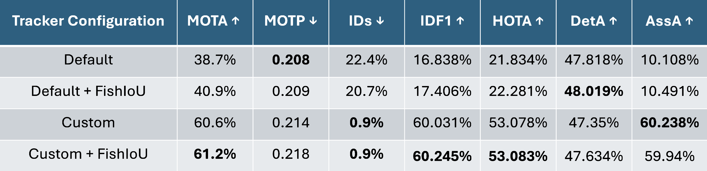
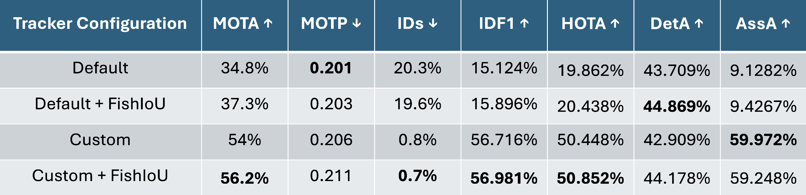

# FishIoU for Ultralytics BoT-SORT

This repository integrates **FishIoU-based data association** into BoT-SORT in **Ultralytics YOLO v8.4.175** for underwater fish tracking.

The FishIoU implementation is adapted from [IMM-Byte-FishIoU](https://github.com/iffatebu/IMM-Byte-FishIoU_based_Tracker) and integrated into BoT-SORT as an optional alternative to standard IoU-based association.

The repository also includes scripts for training YOLO26-L detectors and evaluating single- and multi-class fish tracking on the GFISHERD24 dataset.

## Pipeline

The workflow consists of:

1. Preparing GFISHERD24 data for YOLO training
2. Training YOLO26-L detectors
3. Tracking fish using BoT-SORT with standard IoU or FishIoU association
4. Converting and filtering tracking results
5. Evaluating tracking performance using MOTMetrics and TrackEval

## Installation

Create and activate a Python environment:

```bash
conda create --name gfisherd24-fishiou python=3.10
conda activate gfisherd24-fishiou
```

Clone the repository and install the modified Ultralytics package:

```bash
git clone https://github.com/amlan391/GFISHERD24-FishIoU.git
cd GFISHERD24-FishIoU
pip install -e ./ultralytics
pip install -r requirements.txt
```

The experiments were run on GPU hardware. If needed, install a PyTorch build compatible with your system's CUDA environment.

## Configuration

FishIoU can be enabled or disabled in `ultralytics/ultralytics/cfg/trackers/botsort.yaml`.

**Enable FishIoU:**

```yaml
use_fishiou: True
```

**Use standard IoU:**

```yaml
use_fishiou: False
```

All other tracker settings remain configurable through the same YAML file.

## Modified Files

Four files were modified from the original Ultralytics implementation:

| File | Description |
|---|---|
| `ultralytics/ultralytics/cfg/trackers/botsort.yaml` | FishIoU configuration toggle |
| `ultralytics/ultralytics/trackers/bot_sort.py` | BoT-SORT association integration |
| `ultralytics/ultralytics/trackers/byte_tracker.py` | Secondary association integration |
| `ultralytics/ultralytics/trackers/utils/matching.py` | FishIoU metric and distance calculation |

The complete Ultralytics source code is retained, so no manual replacement of tracker files is required.

## Setting Up GFISHERD24

GFISHERD24 contains more than 155 fish species. The dataset is used for detector training and tracking evaluation, with 155 classes used for multi-class detection.

The dataset follows a 75:15:10 training, validation, and test split.

The source videos and annotations are publicly available. Links and additional information are provided in [`data/README.md`](data/README.md).

Detector training requires extracted image frames and corresponding annotations. The exact image collection and preprocessing steps used in the original experiments are not included in this repository.

Two dataset configurations are provided:

```text
configs/GFISHERD24_single.yaml
configs/GFISHERD24_multi.yaml
```

Update the `path` field in the appropriate configuration file to point to your prepared dataset.

## Training

The training scripts support two YOLO26-L detector configurations:

- **Single-class:** All fish assigned to one `Fish` class
- **Multi-class:** 155 fish classes

Both configurations use the Ultralytics `yolo26l.pt` pretrained checkpoint and train for 75 epochs by default.

**Single-class:**

```bash
python src/train/train.py \
  --data configs/GFISHERD24_single.yaml
```

**Multi-class:**

```bash
python src/train/train.py \
  --data configs/GFISHERD24_multi.yaml
```

The resulting `best.pt` checkpoints can be used for tracking and evaluation.

The `yolo26l.pt` checkpoint is downloaded automatically if it is not already available. See the [Ultralytics YOLO26 documentation](https://docs.ultralytics.com/models/yolo26/) for pretrained model information.

## Model Weights

Trained detector weights are not included in this repository.

After training, organize the checkpoints as:

```text
weights/
├── single_class/
│   └── best.pt
└── multi_class/
    └── best.pt
```

See [`weights/README.md`](weights/README.md) for additional information.

## Tracking

Tracking uses the modified BoT-SORT implementation with the association method selected in the tracker configuration.

The tracking script expects prepared test sequences, with each sequence containing an `img1/` directory of image frames. See [`data/README.md`](data/README.md) for the expected dataset structure.

**Single-class:**

```bash
python src/track/track_dataset.py \
  --model weights/single_class/best.pt \
  --data-root /path/to/mot/test \
  --tracker ultralytics/ultralytics/cfg/trackers/botsort.yaml \
  --output runs/tracking_single
```

**Multi-class:**

```bash
python src/track/track_dataset.py \
  --model weights/multi_class/best.pt \
  --data-root /path/to/mot/test \
  --tracker ultralytics/ultralytics/cfg/trackers/botsort.yaml \
  --output runs/tracking_multi
```

The default detection confidence threshold is `0.3`.

To compare standard BoT-SORT and BoT-SORT with FishIoU, run tracking with each association setting and save the outputs to separate directories.

## Evaluation

The evaluation pipeline is:

```text
track_dataset.py
      ↓
convert_to_mot.py
      ↓
filter_small_boxes.py
      ↓
prepare_evaluation.py
      ↓
evaluate.py
```

Tracking predictions are converted to MOT format, filtered, and evaluated against the prepared ground truth.

### Convert Tracking Results to MOT Format

**Single-class:**

```bash
python src/evaluate/convert_to_mot.py \
  --track-root runs/tracking_single \
  --dataset-root /path/to/mot/test \
  --output runs/mot_single
```

**Multi-class:**

```bash
python src/evaluate/convert_to_mot.py \
  --track-root runs/tracking_multi \
  --dataset-root /path/to/mot/test \
  --output runs/mot_multi
```

### Filter Small Bounding Boxes

Bounding boxes with an area below 800 pixels² are removed before evaluation.

**Single-class:**

```bash
python src/evaluate/filter_small_boxes.py \
  --input runs/mot_single \
  --output runs/mot_filtered_single
```

**Multi-class:**

```bash
python src/evaluate/filter_small_boxes.py \
  --input runs/mot_multi \
  --output runs/mot_filtered_multi
```

### Prepare Evaluation Files

**Single-class:**

```bash
python src/evaluate/prepare_evaluation.py \
  --input runs/mot_filtered_single \
  --gt-root /path/to/mot/test \
  --output runs/evaluation_single
```

**Multi-class:**

```bash
python src/evaluate/prepare_evaluation.py \
  --input runs/mot_filtered_multi \
  --gt-root /path/to/mot/test \
  --output runs/evaluation_multi
```

### TrackEval

Tracking performance is evaluated using MOTMetrics and TrackEval.

Clone TrackEval separately:

```bash
git clone https://github.com/JonathonLuiten/TrackEval.git
```

Provide the path to TrackEval using the `--trackeval-root` argument.

### Run Evaluation

**Single-class:**

```bash
python src/evaluate/evaluate.py \
  --gt-root /path/to/mot/test \
  --evaluation-root runs/evaluation_single \
  --trackeval-root /path/to/TrackEval
```

**Multi-class:**

```bash
python src/evaluate/evaluate.py \
  --gt-root /path/to/mot/test \
  --evaluation-root runs/evaluation_multi \
  --trackeval-root /path/to/TrackEval
```

The evaluation workflow uses 45 GFISHERD24 test sequences.

## Results

The implementation supports comparisons between standard BoT-SORT and BoT-SORT with FishIoU-based association.

### Single-Class Results



### Multi-Class Results



## Repository Structure

```text
GFISHERD24-FishIoU/
├── assets/
│   ├── multi_class_results.png
│   └── single_class_results.png
├── configs/
│   ├── GFISHERD24_multi.yaml
│   └── GFISHERD24_single.yaml
├── data/
│   └── README.md
├── src/
│   ├── evaluate/
│   │   ├── convert_to_mot.py
│   │   ├── evaluate.py
│   │   ├── filter_small_boxes.py
│   │   └── prepare_evaluation.py
│   ├── track/
│   │   └── track_dataset.py
│   └── train/
│       └── train.py
├── ultralytics/
│   ├── ultralytics/
│   │   ├── cfg/trackers/botsort.yaml
│   │   ├── trackers/
│   │   │   ├── bot_sort.py
│   │   │   ├── byte_tracker.py
│   │   │   └── utils/matching.py
│   │   └── ...
│   ├── LICENSE
│   └── pyproject.toml
├── weights/
│   └── README.md
├── README.md
└── requirements.txt
```

## Acknowledgments and References

This implementation builds on the following work:

- **Ultralytics YOLO:** [Ultralytics repository](https://github.com/ultralytics/ultralytics) | [Documentation](https://docs.ultralytics.com/)
- **BoT-SORT:** Nir Aharon, Roy Orfaig, and Ben-Zion Bobrovsky, *BoT-SORT: Robust Associations Multi-Pedestrian Tracking* (2022). [Paper](https://arxiv.org/abs/2206.14651) | [Repository](https://github.com/NirAharon/BoT-SORT)
- **FishIoU:** Adapted from Iffat Era Ebu's [IMM-Byte-FishIoU_based_Tracker](https://github.com/iffatebu/IMM-Byte-FishIoU_based_Tracker).
- **MOTMetrics:** [Repository](https://github.com/cheind/py-motmetrics)
- **TrackEval and HOTA:** Jonathon Luiten et al., *HOTA: A Higher Order Metric for Evaluating Multi-Object Tracking* (2020). [Paper](https://arxiv.org/abs/2009.07736) | [Repository](https://github.com/JonathonLuiten/TrackEval)

This repository focuses on integrating FishIoU into BoT-SORT and does not include the IMM motion model.

## License

Based on Ultralytics, licensed under AGPL-3.0. See [`ultralytics/LICENSE`](ultralytics/LICENSE).